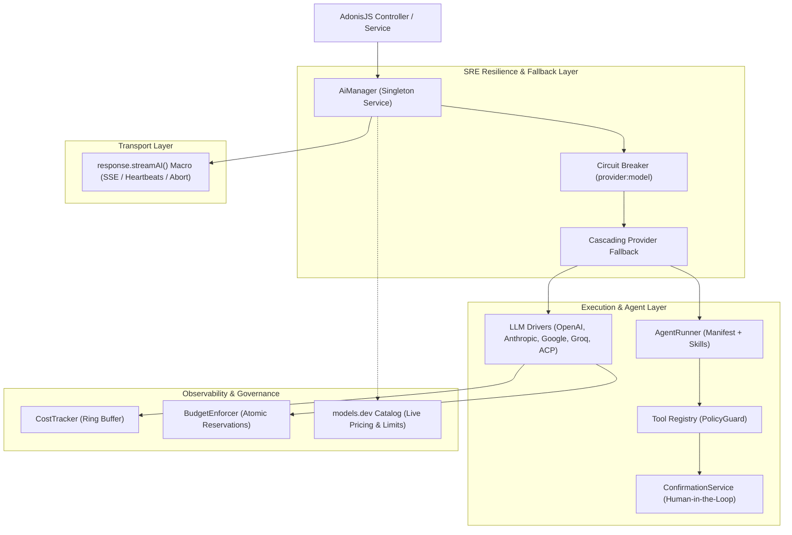

# adonis-ai-kit

> **Production-grade AI & Agentic workflow toolkit for AdonisJS 7**, powered by Vercel AI SDK v7, multi-provider cascading fallback, circuit breakers, tool security guardrails, token budget tracking, models.dev live catalog, and ACP (Agent Client Protocol) coding agents.

[](https://opensource.org/licenses/MIT)
[](https://www.npmjs.com/package/adonis-ai-kit)
[](https://adonisjs.com)
[](https://www.typescriptlang.org)
[](https://sdk.vercel.ai)
[](https://nodejs.org)

---

## Highlights & Architectural Comparison

While frameworks like **Laravel AI** and **Prism** bring basic prompt-level abstractions to PHP, enterprise production systems require strict SRE resilience, tool execution guardrails, cost guarantees, and streaming protocol integrity. **`adonis-ai-kit`** is built from the ground up for high-concurrency Node.js microservices:

| Feature | `adonis-ai-kit` (AdonisJS 7) | Laravel AI / Prism (PHP) |
| :--- | :--- | :--- |
| **Foundation Engine** | **Vercel AI SDK v7** (native Node.js async streams & tool calls) | Custom cURL/Guzzle wrappers |
| **Circuit Breaker** | **Per `provider:model` key** (isolated half-open state, probe limits) | Global or none |
| **Cascading Fallbacks** | **Safe**: never replays side-effects if tool calls already started | Retries from scratch (risk of double actions) |
| **Tool Security (Guardrails)** | **Fail-closed** with Human-in-the-Loop (HITL), concurrent slots | Basic parameter mapping |
| **Token Budget & Cost** | **Live USD pricing**, ring-buffer memory, cache-read & reasoning tokens | Raw token count or static tables |
| **Catalog Auto-Discovery** | **models.dev integration** with TTL cache & atomic writes | Static configuration files |
| **Agent Protocols** | **ACP (Agent Client Protocol)** for Claude Code, opencode & subagents | Basic prompt templates |
| **HTTP Streaming** | **`response.streamAI()` macro** with heartbeats, SSE frames & client-abort hook | PHP chunked response buffers |

---

## Architecture Overview



---

## Installation

```bash
npm install adonis-ai-kit
# or
pnpm add adonis-ai-kit
```

> Package name on npm is `adonis-ai-kit` (the `adonis-ai` name on npm is taken by another project).
> The source repository is [github.com/IvanGlazyrin/adonis-ai-kit](https://github.com/IvanGlazyrin/adonis-ai-kit).

Add the provider to `adonisrc.ts`:

```ts
export default defineConfig({
  providers: [
    // ...
    () => import('adonis-ai-kit/providers/ai_provider')
  ]
})
```

Configure your providers in `config/ai.ts`:

```ts
import env from '#start/env'
import { defineConfig } from 'adonis-ai-kit'

export default defineConfig({
  default: 'openai',
  providers: {
    openai: {
      driver: 'openai',
      apiKey: env.get('OPENAI_API_KEY'),
      defaultModel: 'gpt-6-sol',
    },
    anthropic: {
      driver: 'anthropic',
      apiKey: env.get('ANTHROPIC_API_KEY'),
      defaultModel: 'claude-sonnet-5-5',
    },
  },
  // Automatically fallback to Anthropic if OpenAI is throttled (429) or down (5xx)
  fallbackCascade: ['anthropic'],
  circuitBreaker: {
    failureThreshold: 5,
    recoveryTimeoutMs: 30_000,
    halfOpenMaxAttempts: 2,
  },
})
```

---

## Core Capabilities

### 1. Basic Generation & Multi-Provider Fallback

Generate text with automatic token usage tracking and USD calculation:

```ts
import ai from 'adonis-ai-kit/services/main'

const result = await ai.generateText({
  prompt: 'Explain vector indexing in 3 sentences',
})

console.log(result.text)
console.log(`Duration: ${result.durationMs}ms, Cost: $${result.costUsd}`)
console.log(`Tokens: in=${result.usage.inputTokens}, out=${result.usage.outputTokens}, cached=${result.usage.cacheReadTokens}`)
```

If OpenAI returns `429 Rate Limit` or `503 Service Unavailable`, `adonis-ai-kit` automatically routes the request to `anthropic` with its configured model, recording circuit breaker metrics. A `prompt_too_long` failure also moves on to the next model, but never counts against (or opens) the circuit breaker.

---

### 2. Structured Output with Zod Schema

```ts
import { z } from 'zod'
import ai from 'adonis-ai-kit/services/main'

const resumeSchema = z.object({
  fullName: z.string(),
  skills: z.array(z.string()),
  yearsOfExperience: z.number(),
})

const { object } = await ai.generateObject({
  prompt: 'Extract candidate details: Ivan Glazyrin, 9 years in TS and Go',
  schema: resumeSchema,
})

console.log(object.skills) // ['TypeScript', 'Go', ...]
```

---

### 3. Server-Sent Events (SSE) Streaming in AdonisJS Controllers

Use the built-in `response.streamAI()` macro:

```ts
import type { HttpContext } from '@adonisjs/core/http'
import ai from 'adonis-ai-kit/services/main'

export default class ChatController {
  async stream({ request, response }: HttpContext) {
    const stream = await ai.streamText({
      prompt: request.input('message'),
      model: 'gpt-6-sol',
    })

    // Sets 'Content-Type: text/event-stream', sends heartbeat pings,
    // and automatically calls stream.abort() if the client disconnects!
    return response.streamAI(stream, {
      heartbeatMs: 15_000,
      mode: 'sse',
    })
  }
}
```

#### Structured output with tools in a stream

`schema`, `stopWhen`, `maxRetries` and `onStepFinish` work for both `generateText` and `streamText`:

```ts
import { stepCountIs } from 'ai'
import { z } from 'zod'

const stream = await ai.streamText({
  prompt: 'Find the cheapest flight and summarise it.',
  tools: { searchFlights },
  schema: z.object({ airline: z.string(), priceUsd: z.number() }),
  stopWhen: stepCountIs(6), // takes precedence over `maxSteps`
  maxRetries: 0, // fail fast, let the fallback chain take over
  onStepFinish: (step) => console.log('step done', step.finishReason),
})

for await (const part of stream.fullStream) {
  // forward parts to the client...
}
const flight = await stream.output // parsed against the schema
```

---

### 4. Tool Security Guardrails & Human-in-the-Loop (HITL)

Prevent untrusted AI models from executing destructive operations:

```ts
import { ToolRegistry, ConfirmationService, PolicyGuard } from 'adonis-ai-kit/guard'
import { tool } from 'ai'
import { z } from 'zod'

const confirmationService = new ConfirmationService({ timeoutMs: 60_000 })
const registry = new ToolRegistry(confirmationService)

// Define tools
registry.register(
  'deploy_service',
  tool({
    description: 'Deploy service to cluster',
    parameters: z.object({ cluster: z.string(), service: z.string() }),
    execute: async ({ cluster, service }) => `Deployed ${service} to ${cluster}`,
  }),
  { permission: 'ask', maxCallsPerSession: 1 } // Requires human confirmation!
)

// When the model calls 'deploy_service', confirmationService pauses execution,
// emits a confirmation request event, and resumes only when approved!
```

---

### 5. Cost Tracking & Atomic Token Budget Enforcement

```ts
import { CostTracker, BudgetEnforcer } from 'adonis-ai-kit/budget'

const tracker = new CostTracker({ maxRecords: 10_000 })
const enforcer = new BudgetEnforcer({
  maxCostUsd: 100.0,
  maxInputTokens: 5_000_000,
  maxOutputTokens: 1_000_000,
})

// Atomic pre-flight reservation prevents concurrent race conditions
const reservation = enforcer.reserve('user-session-42', { estimatedCostUsd: 0.05 })
if (!reservation.allowed) {
  throw new Error('Budget exceeded')
}

try {
  // run LLM request...
  enforcer.settle(reservation.reservationId, { costUsd: 0.038 })
} catch (e) {
  enforcer.release(reservation.reservationId)
}
```

---

### 6. ACP (Agent Client Protocol) Coding Agents

Run subagents using local CLI tools like **Claude Code**, **opencode**, or custom ACP binaries with sanitized environments:

```ts
import { AgentRunner, AgentLoader } from 'adonis-ai-kit/agents'

const loader = new AgentLoader({
  configsDir: './resources/agent-configs',
  skillsDir: './resources/agent-skills',
})

const runner = new AgentRunner(aiManager, registry, loader)
const execution = await runner.run({
  agentId: 'code-reviewer',
  userPrompt: 'Audit packages/adonis-ai for race conditions',
})
```

Agents declare the credentials they need and can receive a project MCP server explicitly:

```ts
import { registerAcpAgent, buildAcpRuntimeConfig } from 'adonis-ai-kit/acp'

registerAcpAgent('my-agent', {
  id: 'my-agent', name: 'My Agent', description: '', command: 'my-agent-acp', args: [],
  envVarPrefix: 'ACP_MY_AGENT', supportsMcpServers: true,
  // the first set source is passed to the agent process as `target`
  credentialEnv: [{ target: 'MY_API_KEY', sources: ['MY_API_KEY', 'MY_KEY'] }],
})

const runtime = buildAcpRuntimeConfig('my-agent', {
  projectMcpPath: './mcp/server.js', // used when ACP_MY_AGENT_PROJECT_MCP_PATH is unset
  // the project MCP server is still only attached when ACP_MY_AGENT_ENABLE_PROJECT_MCP=true
})
```

ACP agents in a `models` chain ask a human through the manager's `ConfirmationService` (see `getConfirmationService()`), like the provider cascade does.

Calling `buildAcpRuntimeConfig` + `createACPProvider` directly bypasses the env sanitizing that `AcpDriver` applies: the agent then inherits the full server environment.

The `sourcecraft` and `freebuff` default agents are deprecated and will be removed from the defaults in 2.0; register them with `registerAcpAgent()` if you need them.

---

### 7. Dynamic Credentials & Model Chains

Apps with per-user credentials can't use a static provider cascade. Pass `models` — an ordered chain of
`ResolvedModel | string` — to `generateText`, `streamText` or `generateObject`; the provider cascade is then not used.

```ts
const result = await ai.generateText({
  prompt: 'Summarize this',
  models: [userKeyModel, teamKeyModel, 'anthropic/claude-sonnet-5-5'],
  onFallback: ({ fromModel, toModel, errorClass }) => log.warn(`${fromModel} -> ${toModel} (${errorClass})`),
})
result.provider // providerID of the model that answered
result.model    // its modelID
// fromModel / toModel are breaker keys: the credential key when the model has one, otherwise provider/model
```

- Entries are tried in order. Retryable failures (429, 5xx, network) and entries that cannot be attempted (missing provider
  package, config error, open breaker) move on to the next entry; bad requests, caller aborts and any failure after a
  tool has run are thrown as is. `streamText` falls back on errors before the first chunk.
- Each entry has its own circuit breaker, keyed by `credentialKey` when present (so one bad key doesn't block the others).
- String entries are resolved through `config.resolver` (e.g. a `CatalogModelResolver`); without one a `ProviderConfigError` is thrown.
- Models are built by `config.languageModels` (a `LanguageModelFactory`); when absent a default one is created lazily.
  `manager.shutdown()` shuts it down (stops ACP agents).
- `schema`, `stopWhen`, `maxRetries` and `onStepFinish` work on the chain path too. Empty `models` uses the provider cascade.

## Ace CLI Commands

`adonis-ai-kit` registers helpful Ace commands:

```bash
# Test connectivity, latency, and model availability across configured providers
node ace ai:test

# Scaffold a new production agent prompt and schema
node ace make:ai-agent backend-architect --mode=primary
```

---

## Testing & Quality

The package includes a comprehensive regression test suite with 100% pass rate:

```bash
npm run test:regression
```

- **Token Budget**: Rate calculations, cache-read discounts, reasoning token surcharges, ring-buffer bounded memory.
- **Tool Guard**: Policy enforcement (`allow`, `ask`, `deny`), concurrency slots, fail-closed handlers, session validation.
- **Adonis AI Core**: Cascading failovers without duplicate side-effects, SSE keepalive frames, models.dev live discovery & TTL, ACP command sanitization.

---

## Development & Release

```bash
git clone https://github.com/IvanGlazyrin/adonis-ai-kit.git
cd adonis-ai-kit
npm install
npm run build
npm run test:regression
```

Consume the local build from an AdonisJS app without publishing:

```bash
# in the app
npm install ../path/to/adonis-ai-kit   # file: dependency
# or globally
cd ../adonis-ai-kit && npm link
cd ../my-app && npm link adonis-ai-kit
```

Releases are published to npm by pushing a version tag:

```bash
npm version patch            # bumps package.json + tag v1.1.1
git push --follow-tags       # .github/workflows/release.yml runs npm publish
```

The workflow requires an `NPM_TOKEN` secret in the repository settings.

---

## License

MIT © [Ivan Glazyrin](https://github.com/IvanGlazyrin) (glazrus97@gmail.com)
