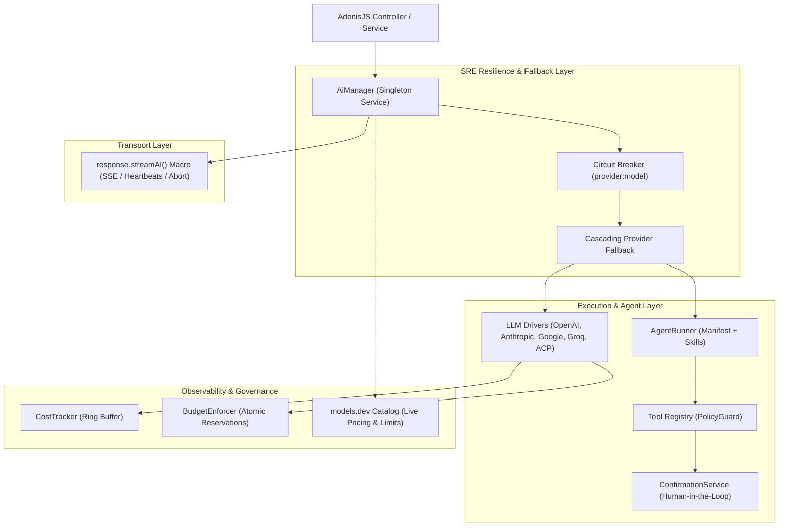

# adonis-ai-kit

> **Production-grade AI & Agentic workflow toolkit for AdonisJS 7**, powered by Vercel AI SDK v7, multi-provider cascading fallback, circuit breakers, tool security guardrails, token budget tracking, models.dev live catalog, and ACP (Agent Client Protocol) coding agents.

[](https://opensource.org/licenses/MIT)
[](https://www.npmjs.com/package/adonis-ai-kit)
[](https://adonisjs.com)
[](https://www.typescriptlang.org)
[](https://sdk.vercel.ai)
[](https://nodejs.org)

---

## Highlights & Architectural Comparison

While frameworks like **Laravel AI** and **Prism** bring basic prompt-level abstractions to PHP, enterprise production systems require strict SRE resilience, tool execution guardrails, cost guarantees, and streaming protocol integrity. **`adonis-ai-kit`** is built from the ground up for high-concurrency Node.js microservices:

| Feature | `adonis-ai-kit` (AdonisJS 7) | Laravel AI / Prism (PHP) |
| :--- | :--- | :--- |
| **Foundation Engine** | **Vercel AI SDK v7** (native Node.js async streams & tool calls) | Hand-written provider drivers on the Laravel HTTP client |
| **Circuit Breaker** | **Per `provider:model` key** (isolated half-open state, probe limits) | Global or none |
| **Cascading Fallbacks** | No fallback once a local tool has run; provider-executed tools and ACP agents: see docs | Non-streaming failover re-runs the call, including executed tools (`Promptable::withModelFailover`); streaming stops failover after the first output |
| **Tool Security (Guardrails)** | Fail-closed `ToolRegistry` (default `deny`); in-process HITL for `ask` tools, or resumable approvals (`approvals: 'resumable'`: signed, stored, survive a restart). `AiManager` tools default to `allow` | Opt-in, persisted tool approvals; `Stop` middleware |
| **Token Budget & Cost** | **Live USD pricing**, ring-buffer memory, cache-read & reasoning tokens | Token counts only, no cost tracking |
| **Catalog Auto-Discovery** | **models.dev integration** with TTL cache & atomic writes | Defaults hard-coded per provider class plus `config/ai.php`; no live catalog |
| **MCP tools** | Through `ToolRegistry` only: default `deny`, names `mcp__<server>__<tool>`, pins against changed definitions, `ask` supported. Tool descriptions are treated as untrusted. `AiManager` tools default to `allow`; MCP tools do not | MCP tools need no approval by default (`needsApproval` returns `false`); names `mcp_tools_<tool>` without the server |
| **Agent Protocols** | **ACP (Agent Client Protocol)** for Claude Code, opencode & subagents | Basic prompt templates |
| **HTTP Streaming** | **`response.streamAI()` macro** with heartbeats, SSE frames & client-abort hook | PHP chunked response buffers |

---

## Architecture Overview



---

## Installation

```bash
npm install adonis-ai-kit
# or
pnpm add adonis-ai-kit
```

> Package name on npm is `adonis-ai-kit` (the `adonis-ai` name on npm is taken by another project).
> The source repository is [github.com/IvanGlazyrin/adonis-ai-kit](https://github.com/IvanGlazyrin/adonis-ai-kit).

Add the provider to `adonisrc.ts`:

```ts
export default defineConfig({
  providers: [
    // ...
    () => import('adonis-ai-kit/providers/ai_provider')
  ]
})
```

Configure your providers in `config/ai.ts`:

```ts
import env from '#start/env'
import { defineConfig } from 'adonis-ai-kit'

export default defineConfig({
  default: 'openai',
  providers: {
    openai: {
      driver: 'openai',
      apiKey: env.get('OPENAI_API_KEY'),
      defaultModel: 'gpt-6-sol',
    },
    anthropic: {
      driver: 'anthropic',
      apiKey: env.get('ANTHROPIC_API_KEY'),
      defaultModel: 'claude-sonnet-5-5',
    },
  },
  // Automatically fallback to Anthropic if OpenAI is throttled (429) or down (5xx)
  fallbackCascade: ['anthropic'],
  circuitBreaker: {
    failureThreshold: 5,
    recoveryTimeoutMs: 30_000,
    halfOpenMaxAttempts: 2,
  },
})
```

---

## Core Capabilities

### 1. Basic Generation & Multi-Provider Fallback

Generate text with automatic token usage tracking and USD calculation:

```ts
import ai from 'adonis-ai-kit/services/main'

const result = await ai.generateText({
  prompt: 'Explain vector indexing in 3 sentences',
})

console.log(result.text)
console.log(`Duration: ${result.durationMs}ms, Cost: $${result.costUsd}`)
console.log(`Tokens: in=${result.usage.inputTokens}, out=${result.usage.outputTokens}, cached=${result.usage.cacheReadTokens}`)
```

If OpenAI returns `429 Rate Limit` or `503 Service Unavailable`, `adonis-ai-kit` automatically routes the request to `anthropic` with its configured model, recording circuit breaker metrics. A `prompt_too_long` failure also moves on to the next model, but never counts against (or opens) the circuit breaker.

Fallback is refused once a side effect may already have happened: after a local tool has run, after a provider-executed tool call (for example a server-side web search) has been made, and after a retryable failure of an ACP agent (its call may have run tools inside the agent). Such failures are thrown as is; this is fail-closed, so an ACP timeout does not switch to another model. This applies to `AiManager` and to `runModelChain`; direct calls to the AI SDK need `attemptSideEffectHooks`. Tokens a failed attempt consumed are recorded in the cost tracker with `failed: true`.

---

### 2. Structured Output with Zod Schema

```ts
import { z } from 'zod'
import ai from 'adonis-ai-kit/services/main'

const resumeSchema = z.object({
  fullName: z.string(),
  skills: z.array(z.string()),
  yearsOfExperience: z.number(),
})

const { object } = await ai.generateObject({
  prompt: 'Extract candidate details: Ivan Glazyrin, 9 years in TS and Go',
  schema: resumeSchema,
})

console.log(object.skills) // ['TypeScript', 'Go', ...]
```

---

### 3. Server-Sent Events (SSE) Streaming in AdonisJS Controllers

Use the built-in `response.streamAI()` macro:

```ts
import type { HttpContext } from '@adonisjs/core/http'
import ai from 'adonis-ai-kit/services/main'

export default class ChatController {
  async stream({ request, response }: HttpContext) {
    const stream = await ai.streamText({
      prompt: request.input('message'),
      model: 'gpt-6-sol',
    })

    // Sets 'Content-Type: text/event-stream', sends heartbeat pings,
    // and automatically calls stream.abort() if the client disconnects!
    return response.streamAI(stream, {
      heartbeatMs: 15_000,
      mode: 'sse',
    })
  }
}
```

#### Structured output with tools in a stream

`schema`, `stopWhen`, `maxRetries` and `onStepFinish` work for both `generateText` and `streamText`:

```ts
import { stepCountIs } from 'ai'
import { z } from 'zod'

const stream = await ai.streamText({
  prompt: 'Find the cheapest flight and summarise it.',
  tools: { searchFlights },
  schema: z.object({ airline: z.string(), priceUsd: z.number() }),
  stopWhen: stepCountIs(6), // takes precedence over `maxSteps`
  maxRetries: 0, // fail fast, let the fallback chain take over
  onStepFinish: (step) => console.log('step done', step.finishReason),
})

for await (const part of stream.fullStream) {
  // forward parts to the client...
}
const flight = await stream.output // parsed against the schema
```

---

### 4. Tool Security Guardrails & Human-in-the-Loop (HITL)

Prevent untrusted AI models from executing destructive operations:

```ts
import { ToolRegistry, ConfirmationService, PolicyGuard } from 'adonis-ai-kit/guard'
import { tool } from 'ai'
import { z } from 'zod'

const confirmationService = new ConfirmationService({ defaultTimeoutMs: 60_000 })
const registry = new ToolRegistry()

// Define tools
registry.registerTool(
  'deploy_service',
  tool({
    description: 'Deploy service to cluster',
    inputSchema: z.object({ cluster: z.string(), service: z.string() }),
    execute: async ({ cluster, service }) => `Deployed ${service} to ${cluster}`,
  }),
  'ask' // Requires human confirmation!
)

const tools = registry.getToolsForAgent('ops-agent', {
  confirmation: confirmationService,
  guard: new PolicyGuard({ maxCalls: 1 }),
})

// When the model calls 'deploy_service', confirmationService pauses execution,
// emits a confirmation request event, and resumes only when approved!
```

---

### 5. Cost Tracking & Atomic Token Budget Enforcement

```ts
import { CostTracker, BudgetEnforcer } from 'adonis-ai-kit/budget'

const tracker = new CostTracker({ maxRecords: 10_000 })
const enforcer = new BudgetEnforcer({
  perSessionMaxCostUsd: 100.0,
  perSessionMaxTokens: 5_000_000,
  perAgentMaxTokens: 1_000_000,
})

// Atomic pre-flight reservation prevents concurrent race conditions
const reservation = enforcer.reserve('support-agent', 4_000, 0.05)
if (!reservation) {
  throw new Error('Budget exceeded')
}

try {
  // run LLM request...
  enforcer.settle(reservation, 3_200, 0.038)
} catch (e) {
  enforcer.release(reservation)
}
```

---

### 6. ACP (Agent Client Protocol) Coding Agents

Run subagents using local CLI tools like **Claude Code**, **opencode**, or custom ACP binaries with sanitized environments:

```ts
import ai from 'adonis-ai-kit/services/main'

// Loads resources/agent-configs/code-reviewer.md and its skills (see `agentConfigsDir` / `agentSkillsDir`)
const runner = await ai.agent('code-reviewer')
const execution = await runner.run('Audit packages/adonis-ai for race conditions')
```

Agents declare the credentials they need and can receive a project MCP server explicitly:

```ts
import { registerAcpAgent, buildAcpRuntimeConfig } from 'adonis-ai-kit/acp'

registerAcpAgent('my-agent', {
  id: 'my-agent', name: 'My Agent', description: '', command: 'my-agent-acp', args: [],
  envVarPrefix: 'ACP_MY_AGENT', supportsMcpServers: true,
  // the first set source is passed to the agent process as `target`
  credentialEnv: [{ target: 'MY_API_KEY', sources: ['MY_API_KEY', 'MY_KEY'] }],
})

const runtime = buildAcpRuntimeConfig('my-agent', {
  projectMcpPath: './mcp/server.js', // used when ACP_MY_AGENT_PROJECT_MCP_PATH is unset
  // the project MCP server is still only attached when ACP_MY_AGENT_ENABLE_PROJECT_MCP=true
})
```

ACP agents in a `models` chain ask a human through the manager's `ConfirmationService` (see `getConfirmationService()`), like the provider cascade does.

Calling `buildAcpRuntimeConfig` + `createACPProvider` directly bypasses the env sanitizing that `AcpDriver` applies: the agent then inherits the full server environment.

The `sourcecraft` and `freebuff` default agents are deprecated and will be removed from the defaults in 2.0; register them with `registerAcpAgent()` if you need them.

#### Skills on demand

By default an agent's skill bodies go into its system prompt. With `skillLoading: on-demand` in the agent's frontmatter, the system prompt lists only each skill's name and description. The model loads a body with the `loadSkill` tool, and the body comes back as a tool result (it stays in the run's history, not in the system prompt).

```md
---
skillLoading: on-demand
skills:
  - grid-trading
---
```

A skill file may start with frontmatter whose `description` the model sees; without it the first `# heading` is used, then the file name. A skill over 256 KB is not loaded in either mode.

- Each `loadSkill` call uses one step of the tool loop, so raise `stop_steps` if a run needs several skills.
- `loadSkill` is reserved: a caller tool with that name is refused, and a manifest `deny` or `ask` for it is a config error. It runs with `allow` and passes through `toolGuard`.
- `runStructured` has no tool loop, so it always gets the full prompt.
- Use it for many or large skills. A few short skills are simpler as `eager` (the default).

#### Sub-agents

`agentAsTool(runner)` lets one agent call another as a tool. The isolation rule:

- The sub-agent receives only the task string. The parent's history is not sent to it. This governs how the call is made, not what the model writes into the task: a parent model can still copy a secret from its history into the task.
- The sub-agent's tools are only those its manifest allows; every other tool is denied (`defaultToolPermission: 'deny'` is forced). Tool guards are not inherited; pass one to `agentAsTool(runner, { toolGuard })`.
- A tool that needs human approval (`ask`) cannot run inside a sub-agent: a manifest with an `ask` tool is refused when the sub-agent tool is created, and an `ask` tool wrapped in the tool registry fails the parent's tool call with `E_AI_SUBAGENT_APPROVAL_REQUIRED`. A tool that starts its own work outside the call chain is not covered.
- A sub-agent that fails returns a tool error (`E_AI_SUBAGENT_FAILED`) to the parent, which goes on. An ACP call failure passes through as `AcpCallFailedError`.
- The parent does not fall back to another model after a sub-agent ran (the sub-agent call is a tool execution).
- Pass `spend: new SubAgentSpend()` to `agentAsTool` and `stopOnBudget(limits, costTracker, { extra: spend })` so the parent's budget counts the sub-agent's tokens and cost. The cost tracker still records the sub-agent under its own agent name.
- Sub-agents nest one level by default (`maxDepth: 1`). A `primary` agent cannot be a sub-agent.

---

### 7. Dynamic Credentials & Model Chains

Apps with per-user credentials can't use a static provider cascade. Pass `models` — an ordered chain of
`ResolvedModel | string` — to `generateText`, `streamText` or `generateObject`; the provider cascade is then not used.

```ts
const result = await ai.generateText({
  prompt: 'Summarize this',
  models: [userKeyModel, teamKeyModel, 'anthropic/claude-sonnet-5-5'],
  onFallback: ({ fromModel, toModel, errorClass }) => log.warn(`${fromModel} -> ${toModel} (${errorClass})`),
})
result.provider // providerID of the model that answered
result.model    // its modelID
// fromModel / toModel are breaker keys: the credential key when the model has one, otherwise provider/model
```

- Entries are tried in order. Retryable failures (429, 5xx, network) and entries that cannot be attempted (missing provider
  package, config error, open breaker) move on to the next entry; bad requests, caller aborts, any failure after a
  tool has run and a retryable failure of an ACP agent are thrown as is. `streamText` falls back on errors before the first chunk.
- Each entry has its own circuit breaker, keyed by `credentialKey` when present (so one bad key doesn't block the others).
- String entries are resolved through `config.resolver` (e.g. a `CatalogModelResolver`); without one a `ProviderConfigError` is thrown.
- Models are built by `config.languageModels` (a `LanguageModelFactory`); when absent a default one is created lazily.
  `manager.shutdown()` shuts it down (stops ACP agents).
- `schema`, `stopWhen`, `maxRetries` and `onStepFinish` work on the chain path too. Empty `models` uses the provider cascade.

### 8. Step Control, Prompt Cache & JSON Recovery

```ts
import { stopOnBudget } from 'adonis-ai-kit/budget'

const result = await ai.generateText({
  system: 'You are a support agent.',
  prompt: 'Find the order and refund it',
  tools,
  maxSteps: 8,
  // Narrow the tools of a step, or stop the tool loop once the budget is spent.
  prepareStep: ({ stepNumber }) => (stepNumber > 2 ? { activeTools: ['refund'] } : undefined),
  stopWhen: stopOnBudget({ maxTokens: 20_000, maxCostUsd: 0.5 }, ai.getCostTracker()),
  // Anthropic prompt cache for the system prompt (one hour). Tools are not cached here: see the note below.
  promptCache: { instructions: '1h' },
  // Repairs a call that names an unknown tool (the error lists the allowed tools).
  repairToolCall: async ({ toolCall }) => toolCall,
})
```

- `prepareStep` runs before each step. A `model` it returns is ignored with a warning: fallback, the circuit breaker
  and cost stay bound to the attempt's model. `AgentRunner` also drops any `instructions` or `system` it returns.
- `activeTools` offers only the named tools; a denied tool stays denied even when named.
- `promptCache` marks Anthropic cache breakpoints (at most four). A one-hour instructions cache needs a one-hour tools
  cache, and a request-level one-hour cache needs every explicit breakpoint to be one hour; other combinations throw
  `E_AI_INVALID_ARGUMENT` before the call. Do not narrow tools per step (`activeTools`, `prepareStep`) when `promptCache.tools`
  is set: a different tool list changes the cached prefix.
- `jsonRecovery: true` with `schema` strips the prose around the JSON answer (`extractFirstJsonValue`). It is off by default.

### 9. Conversations (stored history, owner checked)

`adonis-ai-kit/conversations` keeps a conversation's history in a store. The owner is required and checked by the kit on
every call: a conversation of another owner gives the same answer as an unknown id (`ConversationNotFoundError`, or
`false` from `delete`), and the model is not called.

```ts
const conversation = await ai.conversations.start('user:42')            // owner: a non-empty string, compared with ===
const turn = await ai.generateText({
  prompt: 'What did I ask first?',
  conversation: { id: conversation.id, owner: 'user:42' },
})
turn.conversation // { id, version }: stored after the model answered
```

- A turn is stored as one unit after the model answers: the user messages and the model's response messages. A call that
  fails stores nothing. A stream is stored when it ends normally; an aborted or failed stream stores nothing.
- `version` grows by one per turn; two requests that continue the same version conflict (`ConversationConflictError`),
  and the kit does not repeat the model call.
- The system prompt is not stored: it is sent on every call as `system`. `messages` with `role: 'system'` are sent but not stored.
- `conversation.prepareHistory(messages)` trims what the model sees (for example `pruneMessages` from `ai`). The stored
  history stays complete.
- Binary parts (`Uint8Array`, `ArrayBuffer`, `URL`) cannot be stored: the call throws `E_AI_INVALID_ARGUMENT` before the model is called.
- Stored messages are checked against `ModelMessage` when loaded; a bad one raises `ConversationCorruptError`.
- The default store is in memory and not durable (`store.durable === false`); a restart drops every conversation, and in
  `NODE_ENV=production` a warning is logged. Configure a durable store:

```ts
// config/ai.ts
export default defineConfig({
  // ...
  conversations: { store: new LucidConversationStore() }, // your adapter, see below
})
```

**Adapter contract.** The kit has no database dependency. An application adapter implements `ConversationStore`
(`create`, `load`, `append`, `list`, `delete`, and `durable: true`) and runs the shared contract against itself:

```ts
import { test } from '@japa/runner'
import { conversationStoreContract } from 'adonis-ai-kit/testing'

for (const check of conversationStoreContract(() => new LucidConversationStore())) {
  test(`conversation store: ${check.name}`, () => check.run())
}
```

A table layout that fits the port: `conversations(id, owner, agent_name, version, state json, metadata json, created_at,
updated_at)` and `conversation_messages(id, conversation_id, seq, message json, created_at)`, with an index on
`(owner, updated_at)`. `append` must check `owner` and `expectedVersion` in one transaction and throw
`ConversationNotFoundError` or `ConversationConflictError`. Persistence of files is outside the kit.

### 10. Resumable approvals (survive a restart)

By default an `ask` tool waits in memory for `ConfirmationService`, and a restart loses the wait. With
`approvals: 'resumable'` the run stops at the `ask` tool, its state is stored in the conversation, and a later call
resolves it, in the same process or after a restart:

```ts
// The secret comes from the environment, not from source code. At least 32 bytes.
approvals: { secret: approvalSecret(env.get('AI_APPROVAL_SECRET')), ttlMs: 24 * 60 * 60 * 1000 }

const run = await ai.generateText({
  prompt: 'Delete the old backups',
  tools,
  toolPermissions: { delete_backups: 'ask' },
  approvals: 'resumable',
  conversation: { id: conversation.id, owner: 'user:42' },
})
run.status          // 'awaiting-approval'
run.pendingApprovals // [{ approvalId, toolName, input, expiresAt }]

// Later, possibly after a restart. Every approval of the step needs a decision in this one call.
const done = await ai.conversations.resolveApprovals(conversation.id, 'user:42',
  [{ approvalId: run.pendingApprovals[0].approvalId, approved: true }],
  { tools, toolPermissions: { delete_backups: 'ask' } })
```

- **Signed.** The AI SDK signs each request (HMAC, `experimental_toolApprovalSecret`). A changed tool input, a missing
  signature or a forged `approvalId` does not run the tool: a changed or unsigned request throws `ApprovalSignatureError`
  (`E_AI_APPROVAL_INVALID`) and the step is closed with a denial; an unknown id throws `ApprovalNotFoundError`.
- **At most once.** The decision and the "executing" mark are stored before the tool runs. An approved tool that already
  ran is never run again: a retry (for example after a failed model call) uses its stored result. A tool that was
  executing when the process stopped is reported to the model as "outcome unknown after restart", not run again.
- **Owner and expiry.** The owner is checked as for every conversation call. A decision after `ttlMs` is a denial
  (`reason: 'expired'`, listed in `expiredApprovalIds`). A replayed decision is `ApprovalNotFoundError`.
- **Secret.** Rotating the secret makes the pending requests unverifiable: they are refused (fail-closed). Change it
  when no approval is pending. `approvalSecret()` redacts the value in JSON, `String()` and logs.
- **Store.** `resumable` needs a durable conversation store (`store.durable === true`). The in-memory store is refused
  unless `approvals.allowVolatileStore: true` (tests and development). Concurrent decisions on one step: one wins, the
  other gets `ConversationConflictError`.
- **Limits.** A provider-executed tool (`type: 'provider'`) with `ask` is refused (`E_AI_CONFIG_ERROR`), since the
  provider does not sign approvals. A sub-agent cannot ask (see `agentAsTool`). ACP agents keep `ConfirmationService`.
  A retry after a failed model call re-sends the model the stored results of approved tools; tools with `allow` are
  not approval-gated and run again if the whole turn is retried.

### 11. MCP servers as tools (deny by default)

MCP servers (local stdio or remote HTTP/SSE) reach the model only as tools of `ToolRegistry`. Every tool is denied
until you give it a permission, and every call passes `toolGuard` and the same `ask` confirmation as any other tool.
The kit does not install the MCP client: add `@ai-sdk/mcp` (v2, optional peer dependency).

```ts
// config/ai.ts
mcp: {
  servers: {
    fs: { command: 'node', args: ['./mcp/fs-server.js'], env: { ROOT: '/srv/project' } },        // stdio child process
    docs: { type: 'http', url: 'https://docs.example.com/mcp', headers: { Authorization: `Bearer ${env.get('DOCS_TOKEN')}` } },
  },
  requirePins: false,
}

// start
const registry = ai.getToolRegistry()
await ai.mcp.registerTools(registry)            // connects lazily; a failing server is skipped with a warning
registry.setAgentPermissions('support', {
  mcp__fs__read: 'allow',
  mcp__fs__write: 'ask',                          // needs a confirmation (or resumable approvals)
})

// per call: pass the tools AND the same permissions
const tools = registry.getToolsForAgent('support')
const toolPermissions = Object.fromEntries(Object.keys(tools).map((n) => [n, registry.getAgentPermission('support', n)]))
await ai.generateText({ prompt, tools, toolPermissions })
```

- **Permission.** Without an entry an MCP tool is `deny`, both in `ToolRegistry` and in `AiManager` / `AgentRunner` when
  it is passed directly. `AiManager` looks at `toolPermissions`, not the registry, so pass the registry's permissions
  there as in the example (otherwise the tool is dropped with a warning). `servers.<key>.tools: ['read']` registers only the
  listed tools of that server.
- **Names.** `mcp__<server>__<tool>`; characters outside `[A-Za-z0-9_-]` become `_`. The server key is 1-32 characters of
  `[A-Za-z0-9_-]`, else `E_AI_CONFIG_ERROR`. A name over 64 characters, or one already registered, is not registered
  (warning) and is never cut. The 64-character limit and the character set are the providers' documented limits; the kit
  does not check them against the provider packages.
- **Descriptions are untrusted.** A server's description is stripped of control characters, capped at 1024 characters and
  prefixed with `[MCP:<server>]`. `servers.<key>.describe: { read: '…' }` replaces it with text you wrote. Server
  `instructions` never reach the system prompt.
- **Pins.** `const digests = await ai.mcp.fingerprint('fs')` returns a digest per tool. Put them in `servers.fs.pins`: a tool
  whose definition later changes (the "rug pull") is not registered, with a warning. `requirePins: true` also refuses tools without a pin.
- **Not filtered.** Tool results are not checked. Prompt injection can come through results as well as descriptions. Use
  `ask` for tools with side effects.
- **stdio is a command with your process's rights.** The child gets only a whitelist of the environment (for example `PATH`)
  plus `env` from the config. Run such servers in a container or as a separate user.
- **Lifecycle.** Servers connect on the first `registerTools()`; a repeated call retries the servers that failed. `ai.shutdown()`
  closes the clients. Registered tools stay in the registry (their calls then fail), so create a new registry after a close.
- **Not in v1.** Resources, prompts, completions, elicitation, sampling, MCP Apps, OAuth (`authProvider`; use your own
  transport later), reconnect or refresh on server notifications, and the kit as an MCP server. Without `@ai-sdk/mcp`,
  `registerTools` throws `E_AI_MISSING_DEPENDENCY`.

## Ace CLI Commands

`adonis-ai-kit` registers helpful Ace commands:

```bash
# Test connectivity, latency, and model availability across configured providers
node ace ai:test

# Scaffold a typed AI agent class in app/ai/agents
node ace make:ai-agent SupportChat --provider=openai --model=gpt-6-sol
```

---

## Testing & Quality

The package includes a comprehensive regression test suite with 100% pass rate:

```bash
npm run test:regression
```

- **Token Budget**: Rate calculations, cache-read discounts, reasoning token surcharges, ring-buffer bounded memory.
- **Tool Guard**: Policy enforcement (`allow`, `ask`, `deny`), concurrency slots, fail-closed handlers, session validation.
- **Adonis AI Core**: Cascading failovers with no fallback once a local tool has run (provider-executed tools and ACP agents: see docs), SSE keepalive frames, models.dev live discovery & TTL, ACP command sanitization.

### Fakes for your tests

`adonis-ai-kit/testing` replaces the model, not the manager, so fallback, the circuit breaker, guards and cost tracking run for real:

```ts
import { fakeModel, fakeProvider, fakeTools, fakeApiError } from 'adonis-ai-kit/testing'

const model = fakeModel([
  { toolCalls: [{ name: 'lookup', input: { id: 1 } }] },
  { text: 'done', usage: { input: 100, output: 20, cacheRead: 60 } },
])
const tools = fakeTools({ lookup: () => ({ ok: true }) })

const manager = new AiManager(defineConfig({ default: 'main', providers: { main: fakeProvider(model) } }))
await manager.generateText({ prompt: 'x', tools: tools.tools, maxSteps: 2 })

tools.assertToolCalled('lookup', { id: 1 })
model.assertCalledTimes(2)
```

- A script answers one call per entry (or with a function of the call). An exhausted script throws `FakeScriptExhaustedError`.
- Usage defaults to 10 input and 10 output tokens; set `usage` to test the cost tracker and the budget.
- `fakeApiError(429)` (or 5xx) is classified like a provider error, so fallback can be tested.
- `fakeLanguageModels({ 'provider/model': model })` and `fakeResolver()` cover `models` chains.

---

## Development & Release

```bash
git clone https://github.com/IvanGlazyrin/adonis-ai-kit.git
cd adonis-ai-kit
npm install
npm run build
npm run test:regression
```

Consume the local build from an AdonisJS app without publishing:

```bash
# in the app
npm install ../path/to/adonis-ai-kit   # file: dependency
# or globally
cd ../adonis-ai-kit && npm link
cd ../my-app && npm link adonis-ai-kit
```

Releases are published to npm by pushing a version tag:

```bash
npm version patch            # bumps package.json + tag v1.1.1
git push --follow-tags       # .github/workflows/release.yml runs npm publish
```

The workflow requires an `NPM_TOKEN` secret in the repository settings.

---

## License

MIT © [Ivan Glazyrin](https://github.com/IvanGlazyrin) (glazrus97@gmail.com)
