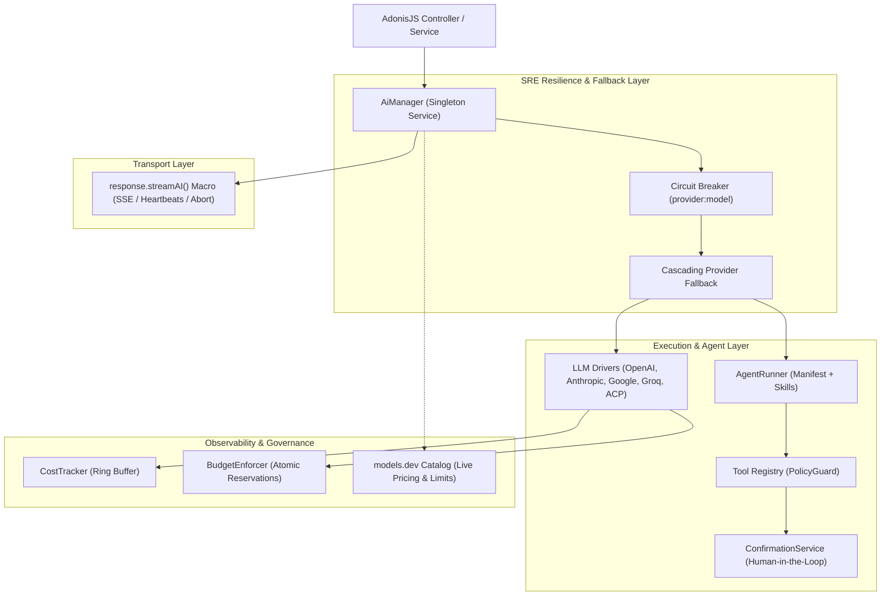

# Introduction

**Adonis AI Kit** (`adonis-ai-kit`) brings production-grade AI and autonomous agentic workflows to the [AdonisJS 7](https://adonisjs.com) framework.

Built atop **Vercel AI SDK v7**, the package pairs TypeScript developer experience with SRE-level operational stability, addressing the unique challenges of high-concurrency Node.js microservices: rate limits, upstream outages, unauthorized tool executions, budget overruns, and process restarts.

---

## Architectural Comparison: Adonis AI Kit vs. Laravel AI

While PHP ecosystems like Laravel AI provide prompt abstractions on top of standard HTTP clients, `adonis-ai-kit` was engineered from the ground up for asynchronous streaming, event loops, and zero-downtime deployments:

| Capability | `adonis-ai-kit` (AdonisJS 7) | Laravel AI / Prism (PHP) |
| :--- | :--- | :--- |
| **Foundation Engine** | **Vercel AI SDK v7** (native Node.js async streams & tool calls) | Custom provider drivers over Laravel HTTP client (`curl` / `Guzzle`) |
| **Circuit Breakers** | **Isolated per `provider:model`** (half-open states, probe limits) | Global or none |
| **Cascading Failovers** | **Strict fail-closed safety**: no failover after a local tool ran, a provider-executed tool was called, or an ACP agent failed | Non-streaming failover re-runs calls, including executed tools (`Promptable::withModelFailover`) |
| **Tool Guardrails** | **Fail-closed `ToolRegistry`** (`deny` default); in-process HITL or signed resumable approvals | Opt-in, persisted tool approvals; `Stop` middleware |
| **Token Budget & Cost** | **Live USD pricing**, ring-buffer memory, cache-read discounts, reasoning surcharges | Token counts only, no monetary cost tracking |
| **Catalog Auto-Discovery**| **models.dev integration** with disk TTL cache & atomic writes | Defaults per provider class plus `config/ai.php`; no live catalog |
| **MCP Integration** | Deny by default, names `mcp__<server>__<tool>`, untrusted description cleaning, SHA-256 pins against changed definitions | MCP tools need no approval by default; names `mcp_tools_<tool>` without the server |
| **Coding Sub-Agents** | **ACP (Agent Client Protocol)** for Claude Code, opencode and others, with a sanitized environment | Basic prompt templates |
| **HTTP Streaming** | **`response.streamAI()` macro** with heartbeats, SSE frames & client-abort hook | PHP chunked response buffers |

---

## Architecture Overview

---

## Next Steps

- Proceed to [Installation](/guide/installation) to install the package and configure peer dependencies.
- Explore [Configuration](/guide/configuration) to set up your AI providers and circuit breaker thresholds.
- Or jump into [Text & Chat Generation](/guide/text-and-chat) to start making your first requests.
