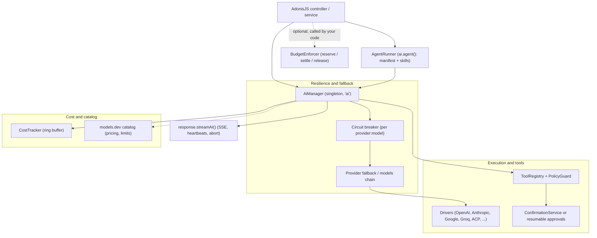

# Introduction

**Adonis AI Kit** (`adonis-ai-kit`) is an AI toolkit for the [AdonisJS 7](https://adonisjs.com) framework: text and structured generation, streaming, tools, agents, and the controls around them.

It is built on **Vercel AI SDK v7**. On top of the SDK it adds provider fallback, circuit breakers, a tool registry that denies by default, token and cost tracking, a live model catalog (models.dev), MCP servers as tools, and ACP coding agents. It deals with rate limits, upstream outages, unapproved tool runs, runaway cost and process restarts.

---

## Comparison: Adonis AI Kit vs. Laravel AI and Prism

Laravel AI and Prism are PHP libraries that wrap provider APIs behind the Laravel HTTP client. `adonis-ai-kit` is a Node.js package that sits on the AI SDK and adds the resilience, tool-control and cost features below. The right-hand column describes what those PHP libraries do at the time of writing; check their documentation for the current state.

| Capability | `adonis-ai-kit` (AdonisJS 7) | Laravel AI / Prism (PHP) |
| :--- | :--- | :--- |
| **Foundation Engine** | **Vercel AI SDK v7** (native Node.js async streams & tool calls) | Custom provider drivers over Laravel HTTP client (`curl` / `Guzzle`) |
| **Circuit Breakers** | **Isolated per `provider:model`** (half-open states, probe limits) | Global or none |
| **Cascading Failovers** | **Fail-closed**: no failover after a local tool ran, a provider-executed tool was called, or an ACP agent failed | Non-streaming failover re-runs the call, including executed tools (`Promptable::withModelFailover`); streaming stops failover after the first output |
| **Tool Guardrails** | **Fail-closed `ToolRegistry`** (`deny` default); in-process HITL for `ask` tools, or signed resumable approvals (`approvals: 'resumable'`) that are stored and survive a restart. Tools passed straight to `AiManager` default to `allow` | Opt-in, persisted tool approvals; `Stop` middleware |
| **Token Budget & Cost** | **Live USD pricing**, ring-buffer memory, cache-read and reasoning tokens | Token counts only, no monetary cost tracking |
| **Catalog Auto-Discovery**| **models.dev integration** with disk TTL cache & atomic writes | Defaults per provider class plus `config/ai.php`; no live catalog |
| **MCP Integration** | Through `ToolRegistry` only: default `deny`, names `mcp__<server>__<tool>`, `ask` supported, tool and parameter descriptions treated as untrusted, SHA-256 pins against changed definitions. Tools passed straight to `AiManager` default to `allow`; MCP tools do not | MCP tools need no approval by default (`needsApproval` returns `false`); names `mcp_tools_<tool>` without the server |
| **Coding Sub-Agents** | **ACP (Agent Client Protocol)** for Claude Code, opencode and others, with a sanitized environment | Basic prompt templates |
| **HTTP Streaming** | **`response.streamAI()` macro** with heartbeats, SSE frames & client-abort hook | PHP chunked response buffers |

---

## Architecture Overview

---

## Next Steps

- Proceed to [Installation](/guide/installation) to install the package and configure peer dependencies.
- Explore [Configuration](/guide/configuration) to set up your AI providers and circuit breaker thresholds.
- Or jump into [Text & Chat Generation](/guide/text-and-chat) to start making your first requests.
